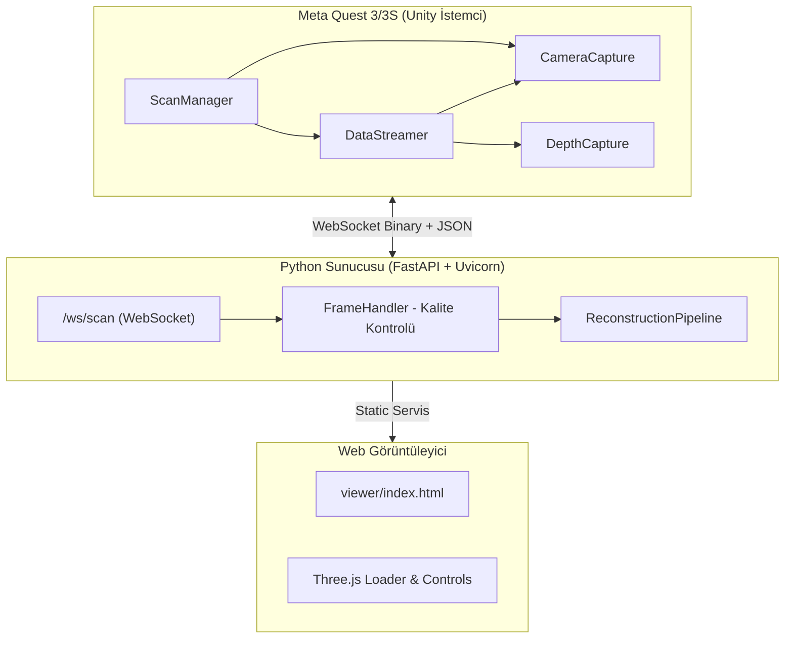

# MetaScan — Meta Quest ile 3D Nesne Taraması ve Görüntü İşleme Pipeline’ı

Bu depo, **görüntü işleme** ve **bilgisayarlı görü** (Computer Vision) kavramlarını bir **karma gerçeklik (MR) başlığı (Meta Quest 3/3S)** üzerinden uçtan uca uygulayan ders projesidir:
Passthrough kameradan alınan RGB görüntüler, başlığın ürettiği **derinlik haritaları (Environment Depth)** ve anlık **baş poz (pose) verileri** gerçek zamanlı olarak bilgisayara aktarılır; sunucu tarafında **kalite kontrolü (bulanıklık ve pozlama analizi)**, **oturum yönetimi** ve **3D yeniden yapılandırma (COLMAP / Open3D TSDF Fusion)** işlemleri gerçekleştirilir.

---

## Özet Mimari ve Veri Akışı

Sistem üç ana bileşenden oluşmaktadır:

| Bileşen | Teknoloji | Rol |
|--------|-----------|-----|
| **İstemci (Başlık)** | Unity (C#), Meta XR SDK (v85) | Passthrough/RGB kareleri yakalar, derinlik haritalarını milimetre cinsinden okur, poz ve iç kamera matrisi ile birlikte ikili (binary) paketler halinde WebSocket üzerinden sunucuya aktarır. |
| **Sunucu (Reconstruction)** | Python (FastAPI, Open3D, OpenCV, COLMAP) | WebSocket üzerinden gelen verileri ayrıştırır, kalite kontrolü yapar, diske kaydeder ve arka planda 3D rekonstrüksiyon (TSDF Fusion veya SfM) işlemlerini yönetir. |
| **Web Görüntüleyici** | HTML5, Three.js (Statik) | Üretilen 3D modelleri (PLY, OBJ, GLB) tarayıcı üzerinde görüntülemeyi sağlayan hafif arayüzdür. |



---

## Dizin Yapısı

```
Meta-Quest-3d-Scan/
├── QuestScanner/          # Unity Projesi (Android / Meta Quest Hedefli)
│   ├── Assets/
│   │   ├── Plugins/Android/
│   │   │   └── AndroidManifest.xml # Scene ve Kamera İzinleri
│   │   ├── Scripts/       # MetaScan ad alanı altındaki C# kodları
│   │   │   ├── SceneBootstrapper.cs
│   │   │   ├── MRSetup.cs
│   │   │   ├── ScanManager.cs
│   │   │   ├── CameraCapture.cs    # RGB Kamera ve Intrinsics Hesaplama
│   │   │   ├── DepthCapture.cs     # Environment Depth API Entegrasyonu
│   │   │   ├── HandUIManager.cs
│   │   │   └── DataStreamer.cs     # WebSocket Binary Protokol Akışı
│   │   └── Resources/     # Proje Konfigürasyon Dosyaları
│   └── ProjectSettings/   # Unity Proje Ayarları
├── server/                # Python FastAPI Sunucusu
│   ├── main.py            # FastAPI API & WebSocket Giriş Noktası
│   ├── frame_handler.py   # Paket Ayrıştırma, OpenCV Kalite Kontrolü (Blur, Exposure)
│   ├── reconstruction.py  # Open3D TSDF Fusion, Outlier Filtreleme ve COLMAP Entegrasyonu
│   ├── config.py          # Sistem Parametreleri ve Eşik Değerler
│   └── requirements.txt   # Sunucu Bağımlılıkları
├── viewer/                # Statik 3D Web Viewer Arayüzü
│   ├── index.html         # Arayüz ve WebGL Görüntüleme Mantığı
│   └── js/                # İnternetsiz çalışma için statik Three.js Kütüphaneleri
└── README.md
```

---

## Son Yapılan Kritik İyileştirmeler ve Çözülen Hatalar

Projenin önceki sürümlerinde karşılaşılan ve 3D taramayı engelleyen temel sorunlar yeni mimari yapıyla tamamen giderilmiştir:

### 1. Meta Quest 3S ve v85 SDK için Derinlik Haritası (Environment Depth) Düzeltmesi
* **Hata:** Derinlik haritası alınamadığı için TSDF Integration devreye girmiyordu ve sadece RGB kareleriyle COLMAP nokta bulutu oluşturulabiliyordu. Sonuçta mesh değil eksik noktalar elde ediliyordu.
* **Çözüm:** 
  * `AndroidManifest.xml` içerisine Quest 3'ün fiziksel çevre algılama yeteneğini kullanabilmesi için `<uses-permission android:name="com.oculus.permission.USE_SCENE" />` izni eklendi.
  * Meta SDK v85 uyumlu `EnvironmentDepthManager` yapısına geçiş yapıldı. `DepthCapture.cs` içerisine `using Meta.XR.EnvironmentDepth;` eklenerek `OVRManager` GameObject'ine çalışma zamanında bu bileşen otomatik bağlandı ve ellerin derinlik haritasından çıkarılması (`RemoveHands = true`) sağlandı.

### 2. Dinamik Kamera İç Parametreleri (Intrinsics) Hesaplama
* **Hata:** Kameranın odak uzaklığı (focal length) sabit/tahmini değerlerle (örn: 448 px) sunucuya gönderildiği için Open3D TSDF Fusion ve COLMAP projeksiyon hesaplamaları hatalı oluyordu (Nesnelerin koordinatları milimetre yerine 133 metre gibi devasa boyutlarda çıkıyordu).
* **Çözüm:** `CameraCapture.cs` içinde Unity Kamerası'nın gerçek projeksiyon matrisi (`projectionMatrix`) dinamik olarak çözümlendi:
  $$f_x = P_{0,0} \cdot \frac{\text{width}}{2}$$
  $$f_y = P_{1,1} \cdot \frac{\text{height}}{2}$$
  Bu sayede başlığın fiziksel kamera kalibrasyonu (OVRManager tarafından güncellenen gerçek donanım matrisi) doğrudan Python rekonstrüksiyon pipeline'ına iletilmektedir.

### 3. Open3D İstatistiksel Gürültü Filtresi (Statistical Outlier Removal) Entegrasyonu
* **Hata:** Taramada oluşan saçma/gürültülü noktalar nedeniyle modelin sınır kutusu (bounding box) devasa boyutlara ulaşıyor, asıl taranan nesne viewer ekranında görünmeyecek kadar küçülüyordu.
* **Çözüm:** `server/reconstruction.py` içerisine istatistiksel aykırı değer temizleme filtresi eklendi:
  ```python
  pcd, ind = pcd.remove_statistical_outlier(nb_neighbors=50, std_ratio=1.0)
  ```
  Bu filtre, komşu noktalarından istatistiksel olarak çok uzak kalan tüm toz ve parazit pikselleri temizleyerek modelin gerçek boyutlarında kalmasını sağlar.

### 4. Web Viewer Vertex Sayım Hatası Giderildi
* **Hata:** Viewer model yüklendiğinde "0 vertices" hatası veriyordu.
* **Çözüm:** `viewer/index.html` üzerinde model ağacı taranırken sadece `THREE.Mesh` değil, nokta bulutu formatındaki nesneleri de kapsayacak şekilde `THREE.Points` kontrolü eklendi. Ayrıca tüm Three.js bağımlılıkları (`viewer/js/`) yerel olarak sunularak harici CDN bağımlılığı kaldırıldı.

---

## İkili (Binary) Çerçeve Protokolü

Ağ bant genişliğini optimize etmek amacıyla, Quest başlığından sunucuya akan her kare tek bir TCP paketi halinde paketlenir. İstemci ile sunucu arasındaki ikili protokolün yapısı şu şekildedir:

1. **Magic Header (4 byte):** Sabit `MSF\x01` imzası.
2. **Metadata (24 byte):**
   * `uint32` Kare Endeksi (Frame Index)
   * `float64` Zaman Damgası (Timestamp)
   * `uint32` JPEG Boyutu
   * `uint32` Derinlik Haritası (Depth) Veri Boyutu
   * `uint32` Poz (Pose) Veri Boyutu
   * `uint32` Kamera İç Parametreleri (Intrinsics) Boyutu
3. **JPEG RGB Payload:** Sıkıştırılmış kamera karesi.
4. **Depth Payload:** `uint16` tipinde, milimetre cinsinden düzleştirilmiş derinlik dizisi (Genişlik × Yükseklik).
5. **Pose Payload:** 7 adet `float32` değer (Pozisyon: X, Y, Z; Rotasyon/Quaternion: X, Y, Z, W).
6. **Intrinsics Payload:** 4 adet `float32` değer (`fx`, `fy`, `cx`, `cy`).

---

## Kurulum ve Çalıştırma

### 1. Sunucuyu Başlatma
Sunucu makinesinde Python 3.10+ yüklü olmalıdır.

```bash
cd server
python -m venv .venv
.venv\Scripts\activate      # Windows için aktif etme
# Linux/macOS için: source .venv/bin/activate
pip install -r requirements.txt
python main.py
```
* Sunucu varsayılan olarak **8765** portunda WebSocket ve HTTP isteklerini dinler.
* Tarayıcınızdan `http://localhost:8765/viewer` adresine giderek 3D görüntüleyiciye erişebilirsiniz.
* *Not:* Tam rekonstrüksiyon (SfM) pipeline'ı için sisteminizde [COLMAP](https://colmap.github.io/) kurulu ve PATH'e eklenmiş olmalıdır.

### 2. Unity (Quest) İstemcisini Derleme
* Unity Hub üzerinden `QuestScanner` klasörünü açın.
* Build Settings'ten platformu **Android** olarak seçin ve Texture Compression'ı **ASTC** yapın.
* **Player Settings -> Scripting Define Symbols** kısmına `META_XR_SDK` tanımını ekleyin.
* Headset'i bilgisayara bağlayıp derleyin ve yükleyin (Build and Run).
* Quest uygulamasını açtığınızda sol elinizdeki menüden bilgisayarınızın yerel IP adresini girip **Connect** tuşuna basarak taramayı başlatabilirsiniz.

---

## Görüntü İşleme ve Bilgisayarlı Görü Kavram Eşleştirmesi

Bu proje kapsamında uygulanan temel akademik konseptler şunlardır:

* **Laplacian Varyansı ile Bulanıklık Analizi:** `frame_handler.py` içinde `cv2.Laplacian` filtresi kullanılarak her kare için kenar keskinliği ölçülür. Belirlenen eşik değerinin altındaki (hareketten dolayı bulanık çıkmış) kareler doğrudan elenir.
* **Histogram ve Ortalama Parlaklık Analizi (Exposure):** Görüntü matrisinin gri tonlama seviyesi (0-255) incelenerek aşırı karanlık veya aşırı patlamış ışıklı sahneler elenir.
* **Pinhole Kamera Modeli ve Kalibrasyon:** Başlıktan alınan projeksiyon matrisinin odak uzaklığı ($f_x, f_y$) ve optik merkez ($c_x, c_y$) bileşenlerine dönüştürülerek 2D piksel koordinatları ile 3D dünya koordinatları arasındaki izdüşüm kurulur.
* **TSDF (Truncated Signed Distance Function) Fusion:** Open3D kullanılarak derinlik haritaları ve kamera dış parametreleri (poz verileri) 3D hacimsel alanda birleştirilir ve yüzey mesh'i (Marching Cubes algoritması benzeri bir mantıkla) oluşturulur.
* **Aykırı Değer Filtreleme (Outlier Removal):** Nokta bulutundaki gürültüleri temizlemek için istatistiksel uzaklık analizi uygulanmıştır.
